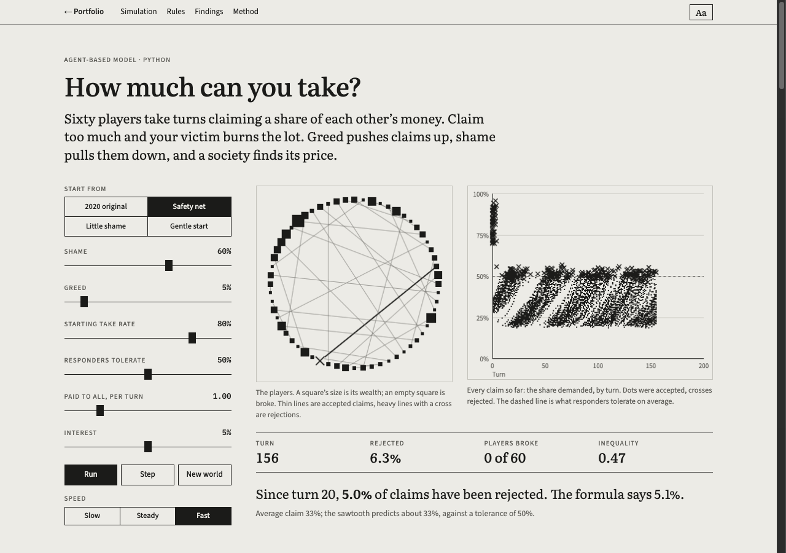

# How much can you take?

An agent-based model of a taking game, with shame and greed. Sixty players are paired at
random each turn. One of each pair claims a share of the other's money; the other either pays
or burns everything they own so the claimant gets nothing. Accepted claimants get greedier,
rejected ones feel shame and ask for less.

**Live, running in your browser: [marianocrimi.com/ultimatum](https://marianocrimi.com/ultimatum/)**
· [Full analysis](https://marianocrimi.com/ultimatum/report/)

[](https://github.com/mcrimi/ultimatumgame_abm/actions/workflows/ci.yml)



I wrote the first version in NetLogo in 2020. This is a rewrite in Python that fixes the
original's pairing bug, explains the model's behaviour in closed form, and ships the same
engine to the browser with a test that the two agree exactly.

## What the model shows

| Finding | Number |
|---|---|
| Responders ruined in the first turn, original settings | 30 of 30 |
| Long-run share of claims rejected: formula / simulation | 5.06% / 5.03% |
| Average claim, when responders would tolerate 50% | 33% |
| Players unable to play after 100 turns, no safety net | 48 of 60 |
| Same, with 1 unit paid to everyone each turn | 0 of 60 |

1. **The first turn is a massacre.** Proposers start by claiming 80%, responders tolerate 50%,
   and every responder destroys their money. The proposers lose nothing.
2. **Claims never settle; they saw.** A take rate rises 5% per accepted claim and falls 60% on
   a rejection: multiplicative increase, multiplicative decrease, the shape of TCP congestion
   control.
3. **The rejection rate depends only on shame and greed.** In log terms a take rate goes up by
   `log(1 + greed)` or down by `-log(1 - shame)`, and since it is bounded the two must cancel:

   ```
   rejection rate = log(1 + greed) / (log(1 + greed) - log(1 - shame))
   ```

   Responders' tolerance sets how high claims climb, not how often they are rejected.
   Simulation agrees with the formula to within 0.004 across 45 settings.
4. **Without a safety net the game dies.** A ruined player earns no interest and never comes
   back. A small payment each turn keeps everyone playing and roughly halves inequality.

It is in fact a *power-to-take* game, not a textbook ultimatum game: the proposer takes from
the responder's money. The setup follows
[Reuben and van Winden (2010)](https://doi.org/10.1016/j.joep.2010.08.001), who found that
punished proposers who felt shame lowered their claims.

## How it is built

```
src/ultimatum_abm/
  rng.py           counter-based random numbers from 32-bit integer maths
  model.py         the game, vectorised over many worlds with NumPy
  theory.py        the rejection-rate law and the sawtooth average
  experiments.py   sweeps over shame, greed, starting take rate and safety net
  export.py        JSON for the page, and trajectories for the parity test
  cli.py           `ultimatum-abm build` and `ultimatum-abm run`
tests/             pytest: rules, conservation of money, theory against simulation
web/               the page: plain HTML, CSS and ES modules, no build step
  js/engine.js     the same model in JavaScript
  test/            node tests, including exact Python-to-JS parity
report/index.qmd   the analysis (Quarto, Python)
docs/ODD.md        model description in the ODD protocol
archive/           the 2020 NetLogo model and its README
```

Things worth a look:

- **One model, two languages, zero drift.** Random numbers are a pure function of
  `(seed, stream, counter)` built from a MurmurHash3 finaliser, so NumPy and JavaScript
  produce identical streams. Python exports full trajectories; `web/test/engine.test.js`
  replays them through the browser engine and requires exact floating-point equality on every
  player, every turn.
- **Theory is tested, not asserted.** `tests/test_theory.py` checks the rejection-rate law
  against simulation, and that changing tolerance leaves it unchanged.
- **Fast.** 2,000 worlds of 100 turns run in about half a second.

### What was wrong with the 2020 version

Responders were linked to whoever stood on neighbouring patches, so a responder could face
several proposers at once, or none, or another responder, and each linked player was paid the
transfer: money appeared from nowhere. Pairing is now one-to-one and money is conserved, with
a test for both. Details are in the [report](https://marianocrimi.com/ultimatum/report/).

## Run it

Needs [uv](https://docs.astral.sh/uv/); Node 20+ for the browser tests; Quarto for the report.

```sh
uv sync --group report
uv run pytest                         # 35 tests
uv run ultimatum-abm run --turn-endowment 1 --turns 400
uv run ultimatum-abm build            # web/data/experiments.json, web/test/fixtures.json
npm test                              # 17 tests, including parity with Python
QUARTO_PYTHON=.venv/bin/python quarto render report/index.qmd
python3 -m http.server -d web 8000    # the page, at http://localhost:8000
```

```python
import numpy as np
from ultimatum_abm import Params, equilibrium, run

params = Params(shame=0.3, greed=0.05, turn_endowment=1.0, turns=400)
history = run(params, seeds=np.arange(200))   # 200 worlds at once
print(history.rejection_rate[150:].mean(), equilibrium(params).rejection_rate)
```

## Limitations

Responders never learn; shame and greed are the same for everyone; destruction is all or
nothing; and the closed-form results assume everyone keeps playing. It is a toy: it shows
what these rules imply, not how people behave.

## Licence and citation

Code is MIT licensed. See `CITATION.cff`.
